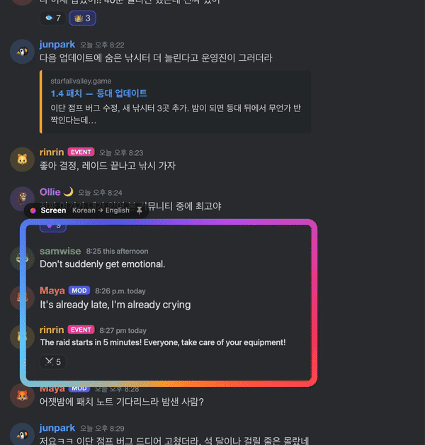

<p align="center">
  
</p>

<h1 align="center">Mwoyeo</h1>
<p align="center"><a href="README.md">한국어</a> · <b>English</b> · <a href="README.ja.md">日本語</a> · <a href="README.zh-CN.md">简体中文</a></p>
<p align="center"><b>Read any screen in your language, right where the text is.</b><br>
Put a lens over a chat, a feed or a game. The original text disappears and the translation is written in its place.</p>

<p align="center">
  <a href="https://github.com/midagedev/mwoyeo/releases/latest"></a>
  <a href="https://github.com/midagedev/mwoyeo/releases"></a>
  
  
  
  <a href="LICENSE"></a>
</p>

```sh
brew install midagedev/tap/mwoyeo
```

<p align="center"></p>

Mwoyeo reads the text under a lens, **erases it from the picture**, and paints the translation back in the same
place, size and colour. It is not a popup or a subtitle bar: the screen simply reads in your language, and keeps
reading as messages arrive and the page scrolls. Everything runs on your Mac; nothing on your screen is sent anywhere.

## Install

```bash
brew install midagedev/tap/mwoyeo
```

Or download the disk image from [Releases](https://github.com/midagedev/mwoyeo/releases/latest) and drag Mwoyeo to
Applications. The app is signed and notarized.

Mwoyeo checks GitHub once a day for a new version and says so in its menu. Update with `brew upgrade mwoyeo`, or
download the new disk image. Settings › About has the check, the switch to turn it off, and links to the release
notes and issue tracker.

### Requirements

| | |
|---|---|
| **macOS** | 26.0 or later (translating without a pack and the *High fidelity* engine: 26.4 or later) |
| **Mac** | Any Mac with Apple silicon (M1 or later) or MacBook Neo that runs macOS 26 or later. There is no Intel build. |
| **Permission** | Screen Recording, nothing else: no Accessibility, no keyboard monitoring |
| **Network** | None for translating. The only request is the daily update check, which you can turn off. |
| **Disk** | About 20 MB for the app. Language packs (and Apple Intelligence's model, up to 8–14 GB) are downloaded and stored by macOS. |
| **Displays** | Any number; a lens can go on any display |

**What runs on device, and what it needs.** Everything runs on your Mac; the only question is which engine is there.

| Part | Needs |
|---|---|
| Reading the text (Vision), erasing it (Core ML) | Nothing more: every Mac above |
| Translating with a **language pack** (fastest, offline) | The pack for your language pair, downloaded once from Mwoyeo's Settings › Translation or System Settings › General › Language & Region › Translation Languages |
| Translating **without a pack**, the *High fidelity* engine and *Glossary first* | **Apple Intelligence** turned on in System Settings › Apple Intelligence & Siri. Translating without a pack and *High fidelity* need macOS 26.4 or later. |

Apple Intelligence runs on every Mac above, but it has two more conditions: your Mac's language and Siri's
language must be the same supported language, and it is not available in mainland China. It supports English,
Korean, Japanese, Chinese, French, German, Spanish, Italian, Portuguese and Vietnamese among Mwoyeo's languages, but
not Russian, Ukrainian or Thai: those translate with language packs only. Without Apple Intelligence, Mwoyeo uses
language packs for everything.

**Languages.** Translate from and into English, Korean, Japanese, Chinese (Simplified and Traditional), French,
German, Spanish, Italian, Portuguese (Brazil), Russian, Ukrainian, Vietnamese and Thai, in any direction macOS has a
translation model for. *Automatic* detects the source language per line. The app itself is in English, Korean,
Japanese, Chinese (Simplified and Traditional), French, German, Spanish, Italian, Portuguese (Brazil), Russian and
Ukrainian.

## Getting started

1. **Open Mwoyeo.** It lives in the menu bar (the viewfinder icon); a welcome window walks you through the rest.
2. **Allow Screen Recording.** Click **Allow** and turn Mwoyeo on in System Settings › Privacy & Security › Screen &
   System Audio Recording. If the lens stays empty afterwards, quit and reopen Mwoyeo.
3. **Pick your languages.** *Translate from* can stay on **Automatic**; *Translate to* starts as your Mac's language.
4. **Get the language pack** (recommended). In Mwoyeo's Settings › Translation, click **Download** next to your
   language pair. With a pack, translation is near-instant and works offline. Without one, Apple Intelligence
   translates instead, which needs no download but takes about half a second per line.
5. **Press ⌃⌥L and drag a box** over the text you want to read, such as the message list of a Discord channel or a
   Reddit thread. Or just click, and a lens is dropped where you clicked. Hold ⌥ while you do it to pin the lens to
   the screen instead of the window (see below).

## Using a lens

- **Move it** by dragging its glowing edge or the name tag on top. Translations stay on the text underneath; only
  what is inside the lens is shown.
- **Resize it** from the bottom-right corner.
- **Close it** with the ✕ on the name tag (hover over the lens to see it).
- **Scroll and chat as usual.** The interior of a lens is click-through, so the page under it works normally. New
  messages are translated as they arrive and scrolling carries the translations along.
- **Window lens or screen lens.** A lens placed on a window is a *window lens* (🪟 on its name tag): it moves with
  that window and hides while the window is minimized or covered. A *screen lens* (📌) stays where you put it and
  translates whatever is under it, whichever app that is: handy for a subtitle line or a spot you keep switching
  apps under. Click the icon on the name tag to switch.
- **Keep lenses small.** A lens around just the part you read (the chat, not the whole browser) translates faster
  and uses less power. You can have several.

The menu bar icon lists your lenses: switch each one on or off, remove it, or add a new one. It also has
**Show Original**, **Pause** and Settings.

### Shortcuts

These work in any app. Change or remove them in Settings › Shortcuts: click a shortcut and press the new keys.
macOS can't tell an app when another one already uses the same keys, so if a shortcut also does something
elsewhere, record a different one. The defaults stay clear of window managers such as Rectangle and Magnet.

| | |
|---|---|
| ⌃⌥L | Add a lens (drag an area, or click to drop one; hold ⌥ to pin it to the screen) |
| ⌃⌥O | Show the original / the translation |
| none | Pause all lenses, Translate again (in the menu; give them keys in Settings if you like) |

## Settings

| Tab | What you can change |
|---|---|
| General | Languages · **Display**: *Adaptive* (default: plain boxes while things move, a seamless rewrite once still), *Quick* (always boxes, least battery) or *Seamless* (always rewrites) · how often the screen is checked (4, 8 or 15 fps) · open at login |
| Translation | **Engine**: *Automatic* (language pack if installed, Apple Intelligence otherwise), *High fidelity* (always Apple Intelligence) or *Glossary first* · language packs · **translation memory**: how many translations to keep for reuse (1,000, 5,000 or 20,000; in memory only, cleared when Mwoyeo quits) · a **glossary** of names, one `original = translation` per line |
| Appearance | **Lens style**: *Glow*, *Subtle* (glows only while reading) or *Minimal* (a faint line; the name tag shows on hover) · font (default, rounded, serif) · box opacity · AI erasing on photos and artwork |

## Tips and troubleshooting

- **Stuck on "Translating…"?** Usually the language pack is missing; download it in Settings › Translation. The very
  first lens after installing also takes a while, because macOS loads its text recognition models once.
- **Names come out wrong** (characters, places, usernames)? Add them to the glossary and choose *Glossary first*.
- **Nothing shows up after an update?** macOS sometimes asks for Screen Recording again. Check it in System Settings,
  then reopen Mwoyeo.
- **Want to compare with the original?** Press ⌃⌥O to see the original, and again to go back.
- **Privacy.** Mwoyeo reads only what is under a lens, never stores or sends it, and leaves its own overlays out of
  what it captures. The only thing it ever asks the internet is GitHub's latest version number, once a day, and
  you can turn that off in Settings › About. The check downloads a small file attached to the release, so GitHub's
  download counts are the usage numbers: an install is counted once, use once a month, and nothing that could identify
  your Mac is sent.

## Under the hood

Every stage uses Apple's on-device frameworks:

| Stage | Technology |
|---|---|
| Capture | ScreenCaptureKit — one stream per lens, Mwoyeo's own overlays excluded, frames only when pixels change |
| Text recognition | Vision `RecognizeDocumentsRequest` (paragraphs) and `RecognizeTextRequest` (lines, regions of interest) |
| Translation | Translation framework — low-latency language packs, or the high-fidelity Apple Intelligence model without a pack |
| Glossary-aware translation | Foundation Models (on-device language model), optional |
| Erasing | Core ML MI-GAN inpainting on the GPU for textured backgrounds, a fast diffusion fill for flat ones |
| Interface | SwiftUI with Liquid Glass, a menu bar extra, global shortcuts, in 12 languages |

### How it works

```
ScreenCaptureKit ──► change map (16 px tiles) ──► scroll? shift blocks, read only the new strip
      │                       │
      │                       └─► changed rows ──► Vision (ROI) ──► erase ──► translate (lens first) ──► overlay
      │
      └─► still for 0.5 s ──► whole-frame paragraph pass ──► seamless re-render, cross-faded in
```

The capture is larger than the lens ("overscan"). At rest the margin is about 30 % of the lens on each side; while
content or the lens moves it grows to about 40 %, shifted toward where things are heading. The lens moves freely
inside the captured area and the capture only re-centres when the lens nears its edge — then just the uncovered strips are read. Unchanged text keeps its
erased background across passes, results computed while content moved are shifted rather than thrown away, and the
translation queue always serves what is visible first.

Scrolling is tracked twice. Trackpad and wheel input move the translations with the page before the next frame
arrives; each captured frame then settles them to the exact offset, measured per column to a fraction of a pixel, so
a fixed sidebar or message box never drags the chat along with it. Only the strip that scrolled into view is read.

Erasing fills flat and gradient backgrounds from their surroundings; on textured ones (artwork, game scenes) an
on-device inpainting model rebuilds the background, and the translation is set in a matching weight and size.

The clip above is the real app on a made-up chat page (`demo/chat.html?lang=ko`), recorded with a real mouse and
trackpad scrolls; `docs/HERO.md` has the shot list.

The name is Korean: *mwoyeo* (뭐여) is a dialect way of saying "what's that?"

## Development

Issues and pull requests are welcome; see [CONTRIBUTING.md](CONTRIBUTING.md).

### Building

```bash
brew install xcodegen
xcodegen generate
xcodebuild -project Mwoyeo.xcodeproj -scheme Mwoyeo -configuration Release -derivedDataPath build/dd build
```

Builds are ad-hoc signed by default, which makes macOS ask for Screen Recording again after every rebuild. Put a
stable identity in `Config/Local.xcconfig` (git-ignored):

```
MWOYEO_SIGN_IDENTITY = <SHA-1 from `security find-identity -v -p codesigning`>
MWOYEO_TEAM = <team id>
```

Core logic (change detection, scroll detection, erasing masks, text fitting, overscan planning) lives in the
`MwoyeoCore` package with its own tests: `cd Core && swift test`.

#### Headless checks

The app binary doubles as a test harness that runs the real pipeline on images:

```bash
APP=build/dd/Build/Products/Release/Mwoyeo.app/Contents/MacOS/Mwoyeo
$APP --render in.png out.png --src ja --tgt ko                     # one still: read, erase, translate, composite
$APP --render page.png frames/ --pan --src ja --tgt ko \
     --lens 200,560,600,300 --to 200,860                            # simulated lens drag, one PNG per step
$APP --render page.png frames/ --pan --scroll --src ja --tgt ko \
     --lens 200,300,600,300 --to 0,400                              # simulated scroll under a still lens
```

`MWOYEO_TRACE=1` prints stage timings; in the live app `MWOYEO_DUMP=<dir>` writes what each lens captured with its
overlay on top.

#### Releasing

Pushing a `v*` tag runs `.github/workflows/release.yml`: it builds with the Developer ID identity from the repository
secrets, notarizes and staples the disk image, publishes the GitHub release and updates the Homebrew cask. Running the
workflow by hand builds and notarizes without releasing. `scripts/release.sh <version> [--publish]` does the same on
a Mac that holds the identity.

#### Demo pages

`demo/chat.html` (a Discord-like server) and `demo/forum.html` (a Reddit-like thread) are made-up pages for
recordings; their parameters (language, new-message rate, scripted scrolls) are listed at the top of each file.
`docs/HERO.md` has the shot list.

## Credits

Inpainting model: [MI-GAN](https://github.com/Picsart-AI-Research/MI-GAN) by Picsart AI Research, MIT licensed
(`tools/inpaint/models/LICENSE-MI-GAN-WEIGHTS`). The Core ML version in `tools/inpaint/models` was converted with
`tools/inpaint/convert_migan.sh`.

## License

MIT
