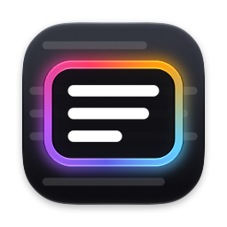
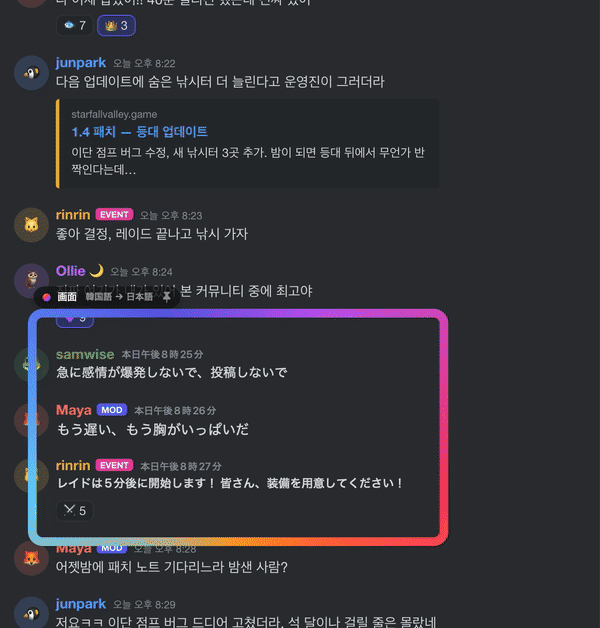

<p align="center">
  
</p>

<h1 align="center">Mwoyeo</h1>
<p align="center"><a href="README.md">한국어</a> · <a href="README.en.md">English</a> · <b>日本語</b> · <a href="README.zh-CN.md">简体中文</a></p>
<p align="center"><b>画面の文字を、その場で読める言葉に。</b><br>
チャットやフィード、ゲームにレンズを重ねるだけ。元の文字が消えて、同じ場所に訳文が書き込まれます。</p>

<p align="center">
  <a href="https://github.com/midagedev/mwoyeo/releases/latest"></a>
  <a href="https://github.com/midagedev/mwoyeo/releases"></a>
  
  
  
  <a href="LICENSE"></a>
</p>

```sh
brew install midagedev/tap/mwoyeo
```

<p align="center"></p>

Mwoyeoはレンズの下にある文字を読み取り、**元の文字を画面から消して**、同じ位置に同じ大きさと色で訳文を描き直します。ポップアップや字幕バーとは違い、画面そのものが日本語で読めるようになります。新しいメッセージが届いても、ページをスクロールしても、そのまま読み続けられます。デフォルトの設定では処理はすべてMacの中で完結し、画面の内容が外部に送られることはありません。クラウド翻訳エンジンを自分で追加したときに限り、レンズが読み取った文字がそのエンジンに送られます。

## インストール

```bash
brew install midagedev/tap/mwoyeo
```

または[Releases](https://github.com/midagedev/mwoyeo/releases/latest)からディスクイメージをダウンロードし、Mwoyeoをアプリケーションフォルダにドラッグしてください。署名済みで、Appleの公証も受けています。

Mwoyeoは1日1回GitHubで新しいバージョンを確認し、見つかればメニューでお知らせします。アップデートするには`brew upgrade mwoyeo`を実行するか、新しいディスクイメージをダウンロードしてください。手動での確認や自動確認のオン/オフ、リリースノートと問題報告ページへのリンクは設定 › 情報にあります。

### 動作環境

| | |
|---|---|
| **macOS** | 26.0以降（言語パックなしの翻訳と*高品質*エンジンは26.4以降） |
| **Mac** | macOS 26以降が動く、Appleシリコン搭載のMac（M1以降）またはMacBook Neo。Intel版はありません。 |
| **許可** | 画面収録のみ。アクセシビリティや入力監視の許可は要りません |
| **ネットワーク** | デフォルトでは翻訳に使いません。通信するのは1日1回のアップデート確認だけで、これもオフにできます。自分で追加したクラウドエンジンだけは例外です。 |
| **ディスク** | アプリ本体は約20 MB。言語パック（とApple Intelligenceのモデル、最大8〜14 GB）はmacOSがダウンロードして保存します。 |
| **ディスプレイ** | 何台でも使え、どのディスプレイにもレンズを置けます |

**オンデバイスで動くものと、必要な条件。** どの処理もMacの中で完結します。環境によって変わるのは、使えるエンジンだけです。

| 機能 | 必要なもの |
|---|---|
| 文字の読み取り（Vision）と消去（Core ML） | 追加の条件はありません。上の条件を満たすMacならどれでも使えます |
| **言語パック**での翻訳（最速・オフライン対応） | 使う言語ペアの言語パック。Mwoyeoの設定 › 翻訳か、システム設定 › 一般 › 言語と地域 › 翻訳言語から一度だけダウンロードします |
| **言語パックなし**の翻訳、*高品質*エンジン、*用語集を優先* | システム設定 › Apple IntelligenceとSiri で **Apple Intelligence** をオンにしておくこと。言語パックなしの翻訳と*高品質*エンジンはmacOS 26.4以降 |

Apple Intelligenceは上の条件を満たすすべてのMacで使えますが、条件があと2つあります。Macの言語とSiriの言語を同じ対応言語にそろえること、そして中国本土では使えないことです。Mwoyeoの対応言語のうちApple Intelligenceが扱えるのは、英語、韓国語、日本語、中国語、フランス語、ドイツ語、スペイン語、イタリア語、ポルトガル語、ベトナム語です。ロシア語、ウクライナ語、タイ語は対象外なので、言語パックでのみ翻訳します。Apple Intelligenceが使えない環境では、Mwoyeoはすべての翻訳を言語パックで行います。

**言語。** 英語、韓国語、日本語、中国語（簡体字・繁体字）、フランス語、ドイツ語、スペイン語、イタリア語、ポルトガル語（ブラジル）、ロシア語、ウクライナ語、ベトナム語、タイ語のあいだで、macOSに翻訳モデルがある組み合わせならどの方向にも翻訳できます。翻訳元を*自動*にしておくと、行ごとに言語を判別します。アプリの表示言語は英語、韓国語、日本語、中国語（簡体字・繁体字）、フランス語、ドイツ語、スペイン語、イタリア語、ポルトガル語（ブラジル）、ロシア語、ウクライナ語に対応しています。

## はじめかた

1. **Mwoyeoを起動します。** メニューバーに常駐し、ビューファインダーのアイコンが表示されます。あとはウェルカムウインドウの案内に沿って進めてください。
2. **画面収録を許可します。** **許可**をクリックし、システム設定 › プライバシーとセキュリティ › 画面収録とシステムオーディオ録音 でMwoyeoをオンにします。それでもレンズに何も表示されないときは、Mwoyeoを一度終了して開き直してください。
3. **言語を選びます。** *翻訳元*は**自動**のままで大丈夫です。*翻訳先*には最初からMacの言語が選ばれています。
4. **言語パックを入れます**（おすすめ）。Mwoyeoの設定 › 翻訳で、使う言語ペアの横にある**ダウンロード**をクリックします。言語パックがあれば翻訳はほぼ一瞬で、オフラインでも使えます。言語パックがなくてもApple Intelligenceが代わりに翻訳します。ダウンロードは要りませんが、1行あたり1秒ほどかかります。
5. **⌃⌥Lを押して、読みたい範囲をドラッグで囲みます。** たとえばDiscordチャンネルのメッセージ一覧や、Redditのスレッドです。クリックするだけでも、その位置にレンズが置かれます。⌥を押しながら操作すると、レンズはウインドウではなく画面に固定されます（後述）。

## レンズの使い方

- **動かすときは**、光っている枠か上の名札をドラッグします。訳文は下の文字に貼り付いたままで、レンズの内側にある分だけが見えます。
- **サイズを変えるときは**、右下の角をドラッグします。
- **閉じるときは**、名札の✕をクリックします。✕はレンズにポインタを重ねると表示されます。
- **スクロールもチャットもいつもどおり。** レンズの内側はクリックが下まで届くので、下のページは普段どおりに操作できます。新しいメッセージは届いたそばから翻訳され、スクロールすれば訳文も一緒に動きます。
- **ウインドウレンズと画面レンズ。** ウインドウの上に置いたレンズは*ウインドウレンズ*（名札に🪟）になり、そのウインドウと一緒に動きます。ウインドウをしまったり、ほかのウインドウに隠れたりしている間は表示されません。*画面レンズ*（📌）は置いた場所から動かず、下にあるものをアプリに関係なく翻訳します。字幕の行や、アプリを切り替えながら見る場所に置くと便利です。名札のアイコンをクリックすると切り替えられます。
- **レンズは小さめに。** ブラウザ全体ではなくチャット部分だけというように、読むところだけを囲むほうが翻訳は速く、電力も少なく済みます。レンズは複数置けます。

メニューバーのアイコンからは、置いているレンズを一覧できます。レンズごとのオン/オフや削除、新しいレンズの追加もここからです。**元のテキストを表示**、**一時停止**、設定もこのメニューにあります。

### ショートカット

ショートカットはどのアプリを使っていても有効です。設定 › ショートカットで変更や削除ができ、ショートカットをクリックして新しいキーを押すと記録されます。ほかのアプリがすでに同じキーを使っていても、macOSにはそれをアプリへ知らせる仕組みがありません。ほかの場所でも別の操作に使われているキーの場合は、別の組み合わせを記録してください。デフォルトのキーは、RectangleやMagnetといったウインドウ管理アプリと重ならないように選んでいます。

| | |
|---|---|
| ⌃⌥L | レンズを追加（範囲をドラッグするか、クリックして配置。⌥を押しながらで画面に固定） |
| ⌃⌥O | 原文と訳文の表示を切り替え |
| なし | すべてのレンズを一時停止、もう一度翻訳（メニューから実行。必要なら設定でキーを割り当てられます） |
| なし | 原文をコピー、読み上げ、レンズの画像を保存（ポインタの下にあるレンズに、なければいちばん新しいレンズに対して実行されます） |

### レンズのメニュー

レンズの名札を右クリックすると、そのレンズでできることがまとめて表示されます。

- **元のテキストを表示**、**原文をコピー**、**翻訳をコピー**: 2つのコピーは、レンズの中の文字を読む順番にそろえてコピーします。
- **読み上げ**: 訳文をシステムの音声で読み上げます。その言語の音声が入っていないときは、システム設定 › アクセシビリティ › 読み上げコンテンツで追加してください。
- **レンズの画像を保存**: 訳文が重なった状態のレンズの画面を、PNGで保存します。
- **（アプリ名）の言語を記憶**: ウインドウレンズでのみ表示されます。今の言語ペアをそのアプリに結び付けておくと、そのアプリが最前面に来たときに言語が自動で切り替わります。言語ペアは一度に1つしか使えないので、最前面にあるアプリの設定がすべてのレンズに適用されます。記憶したアプリは、設定 › 翻訳 › アプリ別の言語から削除できます。

## 画像を翻訳

メニューバーのパネルの下にある写真アイコン（**画像を翻訳…**）をクリックすると、画像翻訳のウインドウが開きます。画像ファイルをドロップするか⌘Vでペーストすると、レンズと同じ方法で元の文字を消し、訳文を描き込みます。結果は画像またはテキストとしてコピーするか、保存できます。

## ほかの翻訳エンジンを追加する

Apple翻訳だけで足りるなら、何もする必要はありません。もっと自然な翻訳がほしいときは、設定 › 翻訳 › **ほかのエンジンを追加…**から、普段使っているエンジンを追加できます。

- **このMac上:** Ollama、LM Studio、自分で立てたLibreTranslateやDeepLXなど。キーは要らず、文字がMacの外に出ることもありません。
- **クラウド:** Gemini、OpenAI、Claude、DeepL、DeepSeek、OpenRouter、Groq、Qwenなど。キーをペーストしてモデルを選ぶと、試し翻訳でその場で接続を確認します。キーはmacOSのキーチェーンにだけ保存されます。
- **自分で接続:** OpenAI互換サーバ、数行で書けるHTTPテンプレート、JSONをやり取りするコマンド。エンジンのセットアップは**セットアップをコピー**で人に渡し、**セットアップをペースト**で受け取れます。キーはセットアップに含まれません。

エンジンを追加すると、メニューバーのパネルにエンジンの切り替えボタンが表示されます。追加したエンジンが応答しなかったり、キーが間違っていたりする間は、代わりにApple翻訳で翻訳し、パネルでそっとお知らせします。設定のエンジン一覧の下には、最初の結果が出るまでの時間と、翻訳メモリからすぐに取り出した割合が表示されます。

> **クラウドエンジンを選ぶと、レンズが読み取った文字がそのエンジンの会社のサーバに送られます。** エンジンを追加する画面にも送信先が書かれています。送るのは文字だけで、画面の画像は送りません。

エンジンごとに簡単に測った結果です（2026-10-17、M1 Pro、3行をまとめて1回翻訳したときの値。測定方法と全体の表は[tools/engine-bench/RESULTS.md](tools/engine-bench/RESULTS.md)にあります）。

| エンジン | モデル | 応答（中央値） | 品質（1–5） | コスト |
|---|---|---|---|---|
| Apple（デフォルト） | Translation framework | 0.15秒 | 3.4 | 無料 |
| DeepL | Free API | 0.88秒 | 4.6 | 無料枠 |
| Gemini | gemini-3.1-flash-lite | 1.27秒 | 4.6 | 無料枠 |
| Claude | claude-haiku-5-5 | 1.12秒 | 4.6 | 有料 |
| OpenAI | gpt-5.6-luna | 1.35秒 | 4.8 | 有料 |
| Ollama | translategemma:4b | 1.00秒 | 3.6 | 無料、このMac上 |

Apple翻訳がいちばん速く、クラウドエンジンは1秒ほど余計にかかる代わりに、文脈を生かした翻訳を返してくれます。

## 設定

| タブ | 変更できる項目 |
|---|---|
| 一般 | 言語 · **表示方法**: *適応型*（デフォルト。動いている間はシンプルなボックスで、止まるとシームレスに書き直し）、*クイック*（常にボックス。バッテリー消費が最小）、*シームレス*（常に書き直し） · 画面チェックの頻度（4、8、15 fps） · ログイン時に開く · **保存**: レンズが読み取った原文と訳文をMarkdownとSRTの記録として残す、記録とレンズの画像を置くフォルダ（デフォルトは`~/Documents/Mwoyeo`） |
| 翻訳 | **エンジン**: *自動*（言語パックがあれば言語パック、なければApple Intelligence）、*高品質*（常にApple Intelligence。いちばん自然ですが最も遅い）、*用語集を優先* · 言語パック · **翻訳メモリ**: 再利用のために覚えておく翻訳の件数（1,000、5,000、20,000。メモリ上にだけ保持し、Mwoyeoを終了すると消えます） · 固有名詞の**用語集**（1行に1つ`原文 = 訳文`の形で） · **ほかのエンジンを追加** · **アプリ別の言語**（レンズのメニューで記憶したアプリがあるときだけ表示） |
| 外観 | **レンズ**: *グロー*、*控えめ*（読み取り中だけ光る）、*ミニマル*（細い線だけ。名札はポインタを重ねたときに表示） · フォント（デフォルト、丸ゴシック、セリフ） · ボックスの不透明度 · 写真やイラストのAI消去 |

## ヒントとトラブルシューティング

- **「翻訳中…」から進まない？** たいていは言語パックが入っていないのが原因です。設定 › 翻訳からダウンロードしてください。また、インストール後に初めて置くレンズは、macOSが文字認識モデルを一度読み込むので少し時間がかかります。
- **キャラクター名や地名、ユーザー名の訳がおかしい？** 用語集に登録して、*用語集を優先*を選んでください。
- **アップデートしたら何も表示されなくなった？** macOSが画面収録の許可をもう一度求めることがあります。システム設定で確認してから、Mwoyeoを開き直してください。
- **原文と見比べたい？** ⌃⌥Oで原文に切り替わり、もう一度押すと訳文に戻ります。
- **プライバシー。** Mwoyeoが読み取るのはレンズの下にあるものだけで、デフォルトの設定では保存も送信もしません。記録の保存をオンにすると、指定したフォルダにだけ書き込みます。クラウドエンジンを追加した場合は、レンズが読み取った文字がそのエンジンに送られます。Mwoyeo自身のオーバーレイもキャプチャから除外しています。それ以外にインターネットに問い合わせるのは、1日1回GitHubで最新のバージョン番号を確認するときだけです。これも設定 › 情報でオフにできます。この確認はリリースに添付された小さなファイルをダウンロードする仕組みなので、GitHubのダウンロード数がそのまま利用統計になります。インストールは1回、利用は月に1回だけ数え、Macを特定できる情報は一切送りません。

## 内部の仕組み

どの段階も、Appleのオンデバイスフレームワークで動いています。

| 段階 | 技術 |
|---|---|
| キャプチャ | ScreenCaptureKit（レンズごとに1ストリーム。Mwoyeo自身のオーバーレイは除外し、ピクセルが変わったときだけフレームを取得） |
| テキスト認識 | Visionの`RecognizeDocumentsRequest`（段落）と`RecognizeTextRequest`（行、関心領域） |
| 翻訳 | Translationフレームワーク（低遅延の言語パック。言語パックがない場合は高品質なApple Intelligenceのモデル） |
| 用語集に沿った翻訳 | オプションでFoundation Models（オンデバイスの言語モデル）を使用 |
| 消去 | 模様のある背景はGPU上のCore ML MI-GANでインペインティング、平坦な背景は高速な拡散塗りつぶし |
| インターフェイス | Liquid Glassを使ったSwiftUI、メニューバーエクストラ、グローバルショートカット、12言語対応 |

### 処理の流れ

```
ScreenCaptureKit ──► change map (16 px tiles) ──► scroll? shift blocks, read only the new strip
      │                       │
      │                       └─► changed rows ──► Vision (ROI) ──► erase ──► translate (lens first) ──► overlay
      │
      └─► still for 0.5 s ──► whole-frame paragraph pass ──► seamless re-render, cross-faded in
```

キャプチャする範囲は、レンズより広めに取っています（オーバースキャン）。余白は静止中ならレンズの各辺に対して約30 %で、コンテンツやレンズが動いている間は約40 %まで広がり、動いていく方向へ寄せます。レンズはこの範囲の中なら自由に動き、端に近づいたときだけキャプチャの中心を合わせ直します。そのときも読み取るのは、新しく見えた帯の部分だけです。変わっていない文字は処理をまたいで消去済みの背景を使い回し、コンテンツが動いている間に計算した結果も捨てずにずらして再利用します。翻訳キューでは、常に画面に見えているものを優先します。

スクロールの追跡は二段構えです。まずトラックパッドやホイールの入力をもとに、次のフレームが届く前に訳文をページと一緒に動かします。続いてキャプチャしたフレームごとに、列単位でピクセル未満の精度まで測ったオフセットにぴたりと合わせます。そのため、固定表示のサイドバーやメッセージ入力欄にチャットの動きが引きずられることはありません。読み取るのは、スクロールで新しく見えた帯の部分だけです。

消去では、単色やグラデーションの背景を周囲の色で塗りつぶします。模様のある背景（イラストやゲーム画面）ではオンデバイスのインペインティングモデルが背景を描き直し、訳文は元の文字に合わせた太さとサイズで組みます。

上の動画は、架空のチャットページ（`demo/chat.html?lang=ko`）の上で実際のアプリを動かし、本物のマウスとトラックパッドでスクロールして収録したものです。撮影リストは`docs/HERO.md`にあります。

名前は韓国語から来ています。*mwoyeo*（뭐여）は「なにそれ？」という意味の方言です。

## 開発

ビルド、テスト、リリースの手順は[英語版README](README.en.md#development)にまとめています。

## クレジット

インペインティングモデルには、Picsart AI Researchの[MI-GAN](https://github.com/Picsart-AI-Research/MI-GAN)（MITライセンス、`tools/inpaint/models/LICENSE-MI-GAN-WEIGHTS`）を使っています。`tools/inpaint/models`にあるCore ML版は、`tools/inpaint/convert_migan.sh`で変換したものです。

## ライセンス

MIT
