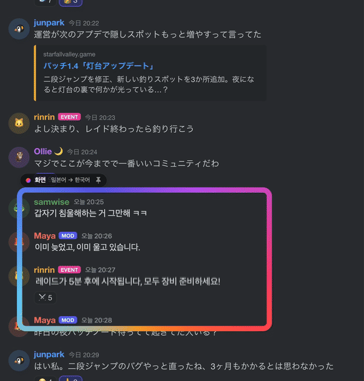

<p align="center">
  
</p>

<h1 align="center">Mwoyeo</h1>
<p align="center"><b>한국어</b> · <a href="README.en.md">English</a> · <a href="README.ja.md">日本語</a> · <a href="README.zh-CN.md">简体中文</a></p>
<p align="center"><b>실시간 화면 번역. 바뀌는 화면을 그 자리에서 바로 한국어로.</b><br>
채팅이 올라오고 자막이 넘어가고 페이지를 스크롤해도, 렌즈 아래 번역이 화면을 따라 바로 바뀌어요.</p>

<p align="center">
  <a href="https://github.com/midagedev/mwoyeo/releases/latest"></a>
  <a href="https://github.com/midagedev/mwoyeo/releases"></a>
  
  
  
  <a href="LICENSE"></a>
</p>

```sh
brew install midagedev/tap/mwoyeo
```

<p align="center">무료 · 오픈소스(MIT) · macOS 26 이상 · Apple silicon(M1 이상) · <a href="https://github.com/midagedev/mwoyeo/releases/latest/download/Mwoyeo-arm64.dmg">디스크 이미지 바로 받기</a></p>

<p align="center"><br>
<sub><a href="docs/media/hero.ko.full.gif">20초 전체 데모 보기 (스크롤, 원문 보기 포함)</a></sub></p>

Mwoyeo는 화면이 바뀌는 동안 계속 번역해요. 렌즈 아래 글자를 쉬지 않고 읽어서 **화면에서 지우고** 같은 자리에
같은 크기와 색으로 번역을 다시 써요. 새 메시지가 올라오면 바로, 자막이 넘어가면 바로, 페이지를 스크롤하면 스크롤하는
대로 번역이 따라와요. 번역 팝업도, 화면 아래 자막 줄도 없어서 원래 한국어로 된 화면을 보는 것처럼 읽혀요. 기본 설정에서는 모든 처리가 Mac 안에서 끝나고 화면 내용은 어디에도
보내지 않아요. 클라우드 번역 엔진을 직접 붙였을 때만 렌즈가 읽은 글자가 그 엔진으로 가요.

## 설치

```bash
brew install midagedev/tap/mwoyeo
```

Homebrew를 안 쓴다면 [디스크 이미지](https://github.com/midagedev/mwoyeo/releases/latest/download/Mwoyeo-arm64.dmg)를 받아
Mwoyeo를 응용 프로그램 폴더로 옮기면 돼요. Apple 공증을 받은 앱이에요.

새 버전은 Mwoyeo가 하루에 한 번 GitHub에서 확인하고 나오면 메뉴에서 알려 줘요. `brew upgrade mwoyeo`를 실행하거나
새 디스크 이미지를 받으면 업데이트돼요. 수동 확인, 자동 확인 끄기, 릴리즈 노트와 이슈 트래커 링크는 설정 › 정보에
모여 있어요.

### 지원 환경

| | |
|---|---|
| **macOS** | 26.0 이상(언어 팩 없이 번역하기와 *고품질* 엔진은 26.4 이상) |
| **Mac** | macOS 26 이상이 설치된 Apple silicon(M1 이상) Mac이나 MacBook Neo면 다 돼요. Intel 버전은 없어요. |
| **권한** | 화면 기록만 있으면 돼요. 손쉬운 사용 권한이나 키 입력 감시는 쓰지 않아요. |
| **네트워크** | 기본 설정에서는 번역할 때 쓰지 않아요. 하루 한 번 하는 업데이트 확인이 전부이고 이것도 끌 수 있어요. 클라우드 엔진을 직접 붙였을 때만 그 엔진과 통신해요. |
| **용량** | 앱은 20MB 정도예요. 언어 팩과 Apple Intelligence 모델(최대 8~14GB)은 macOS가 따로 받아서 관리해요. |
| **디스플레이** | 여러 대를 연결해도 어느 화면에나 렌즈를 놓을 수 있어요. |

**어떤 기능에 무엇이 필요한가요?** 어느 경우든 처리는 Mac 안에서 끝나요. 쓸 수 있는 번역 엔진만 달라져요.

| 기능 | 필요한 것 |
|---|---|
| 글자 인식(Vision), 원문 지우기(Core ML) | 따로 필요한 것 없음. 위 조건에 맞는 Mac이면 다 돼요. |
| **언어 팩**으로 번역(가장 빠르고 오프라인에서도 됨) | 해당 언어 쌍의 언어 팩. Mwoyeo 설정 › 번역이나 시스템 설정 › 일반 › 언어 및 지역 › 번역 언어에서 한 번만 받으면 돼요. |
| 언어 팩 **없이** 번역, *고품질* 엔진, *용어집 우선* | 시스템 설정 › Apple Intelligence 및 Siri에서 **Apple Intelligence**를 켜 두세요. 언어 팩 없이 번역하기와 *고품질* 엔진은 macOS 26.4 이상에서 돼요. |

Apple Intelligence는 위 조건에 맞는 Mac이면 어디서나 돌아가요. 다만 Mac 언어와 Siri 언어를 지원 언어 하나로
똑같이 맞춰야 하고 중국 본토에서는 쓸 수 없어요. Mwoyeo가 다루는 언어 가운데 영어, 한국어, 일본어, 중국어,
프랑스어, 독일어, 스페인어, 이탈리아어, 포르투갈어, 베트남어는 Apple Intelligence가 지원해요. 러시아어,
우크라이나어, 태국어는 지원하지 않아서 언어 팩으로만 번역돼요. Apple Intelligence를 끄고 써도 괜찮아요. 그때는
모든 번역을 언어 팩이 맡아요.

**지원 언어.** 영어, 한국어, 일본어, 중국어(간체·번체), 프랑스어, 독일어, 스페인어, 이탈리아어, 포르투갈어(브라질),
러시아어, 우크라이나어, 베트남어, 태국어 가운데 macOS에 번역 모델이 있는 조합이면 어느 방향으로든 번역해요.
원문 언어를 *자동*으로 두면 줄마다 알아서 판단해요. 앱 화면은 영어, 한국어, 일본어, 중국어(간체·번체), 프랑스어,
독일어, 스페인어, 이탈리아어, 포르투갈어(브라질), 러시아어, 우크라이나어로 나와요.

## 시작하기

1. **Mwoyeo를 실행해요.** 메뉴 막대에 뷰파인더 아이콘이 생기고 환영 창이 나머지를 차례로 안내해요.
2. **화면 기록을 허용해요.** **허용하기**를 누른 다음 시스템 설정 › 개인정보 보호 및 보안 › 화면 및 시스템 오디오
   녹음에서 Mwoyeo를 켜세요. 그래도 렌즈가 비어 있으면 Mwoyeo를 껐다가 다시 켜 주세요.
3. **언어를 골라요.** *원문*은 **자동**으로 두면 되고 *번역*은 처음부터 Mac 언어로 맞춰져 있어요.
4. **언어 팩을 받아요**(권장). Mwoyeo 설정 › 번역에서 언어 쌍 옆의 **내려받기**를 누르세요. 언어 팩이 있으면
   번역이 거의 바로 나오고 인터넷이 끊겨도 돼요. 없으면 Apple Intelligence가 대신 번역해요. 받을 건 없지만 한 줄에
   1초 안팎이 걸려요.
5. **⌃⌥L을 누르고 읽고 싶은 곳을 드래그해요.** 디스코드 채널의 메시지 목록이나 레딧 스레드 같은 곳이요. 드래그
   대신 클릭하면 클릭한 자리에 렌즈가 놓여요. 이때 ⌥를 누르고 있으면 렌즈가 창이 아니라 화면에 고정돼요(아래 참고).

## 렌즈 쓰는 법

- **옮기기:** 빛나는 테두리나 위쪽 이름표를 끌어요. 번역은 아래 글자에 붙어 있어서 렌즈 안에 들어온 부분만 보여요.
- **크기 조절:** 오른쪽 아래 모서리를 끌어요.
- **닫기:** 렌즈에 포인터를 올리면 이름표에 ✕가 나타나요.
- **스크롤도 채팅도 평소처럼.** 렌즈 안쪽은 클릭이 그대로 통과해서 아래 페이지를 그냥 쓰면 돼요. 새 메시지는
  올라오는 대로 번역되고 스크롤하면 번역도 같이 따라와요.
- **창 렌즈와 화면 렌즈.** 창 위에 놓은 렌즈는 *창 렌즈*예요(이름표에 🪟). 창을 옮기면 따라오고 창을 최소화하거나
  다른 창이 가리면 숨어요. *화면 렌즈*(📌)는 놓은 자리에 계속 있으면서 아래에 어떤 앱이 오든 번역해요. 자막이
  나오는 줄이나 여러 앱을 번갈아 띄우는 자리에 좋아요. 이름표의 아이콘을 누르면 둘 사이를 바꿀 수 있어요.
- **렌즈는 작게.** 브라우저 전체보다 채팅 영역처럼 실제로 읽는 부분만 감싸야 번역이 빠르고 배터리도 덜 써요.
  렌즈는 여러 개 띄울 수 있어요.

메뉴 막대 아이콘을 누르면 렌즈 목록이 나와요. 여기서 렌즈를 하나씩 켜고 끄거나 지우고 새로 추가할 수 있어요.
**원문 보기**, **일시정지**, 설정도 이 메뉴에 있어요.

### 단축키

어느 앱을 쓰고 있든 동작해요. 설정 › 단축키에서 바꾸고 싶은 단축키를 누른 다음 새 키를 입력하면 돼요. 지울 수도
있어요. 다른 앱이 이미 같은 키를 쓰고 있어도 macOS는 알려 주지 않아요. 단축키를 눌렀는데 다른 일이 같이 일어나면
다른 키로 바꿔 주세요. 기본 단축키는 Rectangle이나 Magnet 같은 창 관리 앱과 겹치지 않게 골랐어요.

| | |
|---|---|
| ⌃⌥L | 렌즈 추가(드래그해서 영역 지정, 클릭하면 그 자리에 놓기, ⌥를 누르고 있으면 화면에 고정) |
| ⌃⌥O | 원문 보기 / 번역 보기 |
| 없음 | 모든 렌즈 일시정지, 다시 번역(메뉴에 있어요. 필요하면 설정에서 키를 지정하세요) |
| 없음 | 원문 복사, 소리 내어 읽기, 렌즈 이미지 저장(포인터 아래 렌즈에, 없으면 가장 최근 렌즈에 적용돼요) |
| 없음 | 텍스트 번역 창 열기 |

### 렌즈 메뉴

렌즈 이름표를 오른쪽 클릭하면 그 렌즈에서 할 수 있는 일이 모여 있어요.

- **원문 보기**, **원문 복사**, **번역 복사**: 렌즈 안 글자를 읽는 순서대로 복사해요.
- **소리 내어 읽기**: 번역을 시스템 음성으로 읽어 줘요. 그 언어 음성이 없으면 시스템 설정 › 손쉬운 사용 › 읽기 및
  말하기에서 추가하세요.
- **렌즈 이미지 저장**: 번역이 올라간 렌즈 화면을 PNG로 저장해요.
- **(앱 이름)에서 이 언어 기억하기**: 창 렌즈에서만 보여요. 지금 언어 쌍을 그 앱의 프로필로 기억해요. 렌즈마다 자기가
  덮은 창의 프로필로 번역하니까, 앱 A를 앞에 두고 앱 B 위에 놓은 렌즈는 B의 언어와 엔진을 써요.
- **(앱 이름) 메모리…**: 그 렌즈가 쓰는 프로필의 이름·용어와 메모를 열어요.
- **프로필: …**: 프로필이 하나라도 있으면 보여요. 하위 메뉴에서 이 렌즈만 한 프로필에 고정하거나 *자동*으로 되돌리고,
  *이 창의 새 프로필…*로 지금 창 제목에 맞는 프로필을 만들어요.

## 이미지 번역

메뉴 막대 패널 아래쪽의 사진 아이콘을 누르면 이미지 번역 창이 열려요. 그림 파일을 끌어다 놓거나 ⌘V로 붙여 넣으면
렌즈와 같은 방식으로 원문을 지우고 번역을 그려 넣어요. 결과는 이미지나 텍스트로 복사하거나 저장할 수 있어요.

## 텍스트 번역

읽고 싶은 글이 늘 렌즈 아래에 있는 건 아니에요. 메뉴 막대 패널 아래쪽의 말풍선 아이콘(**텍스트 번역…**, 앱 메뉴에도
있어요)을 누르고 왼쪽 칸에 글을 입력하거나 붙여 넣으면 오른쪽에 번역이 원문과 같은 모양으로 나와요. **복사**로 가져가세요.
기본 Apple 엔진은 입력을 멈추면 바로 번역해요. 직접 추가한 엔진은 ⌘↩나 **번역**을 눌러야 보내요. 쓰다 만 문장이 서버로
가지 않게 하려는 거예요. 창은 방금 쓰던 앱의 프로필을 따라가서, 그 앱의 렌즈와 같은 언어, 엔진, 이름, 다시 쓰기 규칙을
써요. 팝업에서 다른 프로필을 고를 수도 있어요.

어느 앱에서든 글을 선택하고 서비스 메뉴(앱 메뉴 아래나 오른쪽 클릭 메뉴)에서 **Mwoyeo로 번역**을 고르면 돼요. 단축어 앱의
**텍스트 번역** 동작은 글과 번역할 언어(생략 가능)를 받아 번역을 돌려주니까 Spotlight나 직접 만든 단축어에서도 쓸 수 있어요.
기본 단축키는 없어요. 필요하면 설정 › 단축키에서 지정하세요.

## 다른 번역 엔진 붙이기

Apple 번역만으로 충분하면 아무것도 할 필요 없어요. 더 자연스러운 번역이 필요하면 설정 › 번역 › **다른 엔진
추가…**에서 자기가 쓰는 엔진을 붙일 수 있어요.

- **이 Mac에서:** Ollama, LM Studio, 직접 띄운 LibreTranslate나 DeepLX. 키가 필요 없고 글자가 Mac 밖으로
  나가지 않아요.
- **클라우드:** Gemini, OpenAI, Claude, DeepL, DeepSeek, OpenRouter, Groq, Qwen 등. 키를 붙여 넣고 모델을 고르면
  시험 번역으로 연결을 바로 확인해요. 키는 macOS 키체인에만 저장돼요.
- **직접 연결:** OpenAI 호환 서버, 몇 줄로 적는 HTTP 템플릿, JSON을 주고받는 명령어. 엔진 구성은 **구성 복사**로
  남에게 넘기고 **구성 붙여 넣기**로 받을 수 있어요. 키는 구성에 들어가지 않아요.

엔진을 붙이면 메뉴 막대 패널에 엔진 전환 버튼이 생겨요. 붙인 엔진이 응답하지 않거나 키가 틀리면 그 사이에는
Apple 번역으로 대신 번역하고 패널에 조용히 알려 줘요. 설정의 엔진 목록 아래에는 첫 결과까지 걸린 시간과 번역
메모리에서 바로 꺼낸 비율이 나와요.

> **클라우드 엔진을 고르면 렌즈가 읽은 글자가 그 엔진 회사의 서버로 가요.** 엔진을 추가하는 화면에도 어디로 가는지
> 적혀 있어요. 화면 이미지는 보내지 않고 글자만 보내요.

엔진별로 간단히 재 본 결과예요(2026-10-17, M1 Pro, 세 줄 묶음 한 번 기준. 측정 방법과 전체 표는
[tools/engine-bench/RESULTS.md](tools/engine-bench/RESULTS.md)).

| 엔진 | 모델 | 응답(중앙값) | 품질(1–5) | 비용 |
|---|---|---|---|---|
| Apple(기본) | Translation framework | 0.15초 | 3.4 | 무료 |
| DeepL | Free API | 0.88초 | 4.6 | 무료 등급 |
| Gemini | gemini-3.1-flash-lite | 1.27초 | 4.6 | 무료 등급 |
| Claude | claude-haiku-5-5 | 1.12초 | 4.6 | 유료 |
| OpenAI | gpt-5.6-luna | 1.35초 | 4.8 | 유료 |
| Ollama | translategemma:4b | 1.00초 | 3.6 | 무료, 이 Mac |

Apple 번역이 가장 빠르고, 클라우드 엔진은 1초 남짓 더 걸리는 대신 문맥을 살린 번역을 돌려줘요.

## 이름이 줄마다 다르게 나올 때: 프로필, 문맥, 다시 쓰기

게임이나 채팅에서 같은 사람 이름이 줄마다 다르게 번역되는 건 엔진이 그 줄 하나만 보고 번역하기 때문이에요.
Mwoyeo에는 이걸 막는 장치가 네 가지 있어요.

| | 어디에 쓰나 | 어디서 바꾸나 |
|---|---|---|
| **용어집** | 모든 앱에서 늘 같은 이름(내 닉네임, 자주 보는 고유명사) | 설정 › 번역 › 용어집 |
| **프로필** | 어떤 앱이나 창에서만 쓰는 언어, 엔진, 이름과 용어, 번역가에게 주는 메모(게임 등장인물, 지명, 말투) | 렌즈 메뉴 › *(앱 이름) 메모리…*, 설정 › 번역 › 프로필 |
| **문맥** | 번역할 줄과 함께 앞의 몇 줄과 창 제목을 보내서 누가 누구에게 하는 말인지 알게 하기 | 추가한 엔진의 시트 › **문맥**, 프로필의 *사용자화* |
| **다시 쓰기** | 번역 전 원문이나 번역 후 결과에서 정해 둔 글자를 바꾸기(토큰 0) | 프로필의 *사용자화* › 다시 쓰기, 스크립트 |

- **프로필**은 렌즈 메뉴에서 이름을 한 번 적거나 *(앱 이름)에서 이 언어 기억하기*를 고르면 생겨요. 조건(앱, 창 제목에
  든 문구, 둘 다)을 달면 그 창을 덮은 렌즈가 알아서 골라 써요. 창 제목과 앱이 둘 다 맞는 프로필이 먼저, 그다음 제목,
  그다음 앱, 아무것도 안 맞으면 *모든 앱*이에요. 메뉴바나 렌즈 메뉴에서 손으로 고정할 수도 있어요. 1.1.4의 앱별
  메모리는 그대로 프로필이 돼요.
- **이름마다 쓰는 방법을 골라요.** *번역기에 알려 주기*는 그 이름이 나온 줄에 힌트로 함께 보내요(토큰이 들어요).
  *원문에 바꿔 넣기*는 번역하기 전에 원문의 이름을 번역으로 바꿔 넣어요(무료). Apple 번역에 이름을 지키게 하는 방법은
  바꿔 넣기뿐이라 Apple이 번역하는 곳에서는 이쪽을 권해요. 둘 다 고를 수도 있어요. 엔진이 번역하면서 배운 이름은
  *배운 것*에 흐리게 보이고, 누르면 고정돼요.
- **다시 쓰기**는 프로필마다 찾아 바꾸기 규칙을 32개까지 둬요(정규식 가능). 그걸로 모자라면 JavaScript로
  `before(line, ctx)`와 `after(src, dst, ctx)`를 써요. 스크립트는 네트워크도 파일도 없는 별도 서비스에서 줄마다
  50 ms 안에 돌고, 넘기면 꺼져요.
- **엔진마다 받는 방식이 달라요.** 채팅 서버(Ollama, OpenAI 호환)와 Anthropic 엔진은 문맥을 꺼 둬도 메모와 이름을 받아요.
  DeepL은 엔진 시트의 *DeepL에 내 메모 사용*을 켜면 메모와 이름이 DeepL 지시문으로 가요. Apple 번역은 바꿔 넣은
  이름만 받아요.
- **무엇이 함께 가는지는 엔진 시트와 프로필의 "보냄:" 줄에 그대로 나와요.** 문맥과 창 제목은 기본으로 꺼져 있어요.
  클라우드 엔진이면 그 줄들도 엔진 회사로 가요.
- **어떤 엔진이 이름을 잘 지키나요?** 저희가 게임 장면으로 재 보니 DeepL Free는 메모리의 이름을 모든 줄에서
  지켰어요(九十九 → 츠쿠모, 8줄 중 8줄). 4B 정도의 작은 로컬 모델은 이름을 줘도 줄마다 흔들릴 수 있어요.

메모리를 손으로 채우기 번거로우면 Claude Code 같은 에이전트에게 맡길 수 있어요. 아래 [에이전트 연결 (MCP)](#에이전트-연결-mcp)를
보세요. 번역 로그를 읽고 줄마다 달라진 이름을 찾아 그 앱의 메모리에 써 줘요.

## 설정

| 탭 | 바꿀 수 있는 것 |
|---|---|
| 일반 | 언어 · **표시 방식**: *적응형*(기본값. 움직이는 동안엔 상자로 보여 주고 멈추면 원문을 지우고 다시 씀), *빠르게*(늘 상자, 배터리를 가장 적게 씀), *자연스럽게*(늘 지우고 다시 씀) · 화면 확인 빈도(4, 8, 15fps) · 로그인 시 실행 · **저장**: 렌즈가 읽은 원문과 번역을 Markdown·SRT 기록으로 남기기, 기록과 렌즈 이미지를 둘 폴더(기본 `~/Documents/Mwoyeo`) |
| 번역 | **엔진**: *자동*(언어 팩이 있으면 언어 팩, 없으면 Apple Intelligence), *고품질*(늘 Apple Intelligence. 가장 자연스럽지만 가장 느려요), *용어집 우선* · 언어 팩 · **번역 메모리**: 한 번 번역한 문장을 몇 개까지 기억해 둘지(1,000, 5,000, 20,000개. 메모리에만 두고 Mwoyeo를 끄면 사라져요) · 이름을 정해 두는 **용어집**(한 줄에 `원문 = 번역` 하나씩) · **다른 엔진 추가** · **프로필**(프로필이 있을 때만 보여요) |
| 표시 | **렌즈 스타일**: *글로우*, *은은하게*(읽는 동안에만 빛나요), *모서리*(네 모서리만 그려요), *최소*(옅은 선만 보이고 이름표는 포인터를 올리면 나타나요) · **색상**: 스펙트럼, 강조 색상, 오션, 선셋, 포레스트, 모노 · **이름표**: 표시(자동, 항상, 포인터를 올렸을 때)와 위치(네 모서리) · 글꼴(기본, 둥근, 명조) · 상자 불투명도 · 사진이나 그림 위 글자는 AI로 지우기 |

탭에서 기본값과 다른 항목이 있으면 맨 아래에 *기본값 복원…*이 보여요. 무엇이 바뀌고 무엇이 그대로인지(권한 동의, 메모리,
기록) 먼저 보여 주고, 복원한 뒤 바로 실행 취소할 수 있어요.

### 설정 파일

모든 설정은 JSON 파일로도 있어서, 클릭하지 않고 직접(또는 Claude Code에게 시켜서) 바꿀 수 있어요. 파일 위치는 `~/Library/Application Support/Mwoyeo/settings.json`이고, `Mwoyeo --settings-path`로 확인하거나 설정 › 일반의 *열기* 버튼으로 열 수 있어요.

- 파일을 저장하면 1초 안에 바로 적용돼요. 설정 창과 파일은 늘 같은 내용이에요.
- 옆에 있는 `settings.schema.json`에 키마다 설명과 고를 수 있는 값, 범위가 적혀 있어요. 목록 안의 항목(엔진, 앱별 설정)도 마찬가지예요. JSON Schema를 읽는 편집기라면 키를 자동 완성하고 검사해 줘요. `Mwoyeo --settings-schema`로 스키마를 바로 출력할 수도 있어요.
- `Mwoyeo --check-settings [경로]`는 문제가 없으면 `ok`를 출력해요(1.1.4 모양의 파일이면 그 앞에 변환 안내 한 줄이 붙어요). 문제가 있으면 하나에 한 줄씩 출력하고 종료 코드 1로 끝나요. 예: `settings.json:14: engines[0].thinking: "maybe" is not allowed; use one of off, provider; ignored`
- 한 줄은 `<줄>: <경로>: <무엇이 틀렸나>; <어떻게 했나>` 순서예요. 목록 안의 값도 정확한 줄 번호와 경로(`engines[0].thinking`)로 알려 주고, 모르는 키에는 가장 비슷한 키를 알려 줘요.
- 끝부분은 셋 중 하나예요. `keeping the current value`는 설정 전체가 잘못돼 원래 값을 그대로 둔다는 뜻이에요. `ignored`는 항목 안의 선택 값 하나만 무시하고 항목은 적용한다는 뜻이고, `dropped`는 목록에서 그 값 하나만 빼고 나머지를 적용한다는 뜻이에요. JSON이 깨진 파일은 고칠 때까지 건드리지 않아요.
- 에이전트에게 맡길 때 알아 둘 내용은 [docs/settings-for-agents.md](docs/settings-for-agents.md)에 있어요.
- 추가한 엔진의 API 키는 파일에 들어가지 않고 키체인에만 있어요.

**번역 로그.** `"savesTranscripts": true`로 두면 렌즈마다 읽은 원문과 번역을 `<exportFolder>/Transcripts`에 남겨요(기본은 Markdown과 SRT). `transcriptFormats`에 `"jsonl"`을 더하면 번역된 줄마다 JSON 한 줄씩, 생기는 즉시 덧붙여요.

```json
"savesTranscripts": true,
"transcriptFormats": ["markdown", "srt", "jsonl"]
```

```sh
tail -f ~/Documents/Mwoyeo/Transcripts/*.jsonl
# {"time":"2026-10-18T10:52:02.030+09:00","lens":"Chat","app":"com.example.app","source":"auto","target":"ko","engine":"apple","original":"こんにちは","translation":"안녕하세요"}
```

설정을 바꾸고 싶으면 Claude Code에게 *"렌즈 테두리를 은은하게 하고 일본어로 번역하게 해 줘"*처럼 말하면 돼요. 스키마를 읽고 키 두 개를 고친 뒤 `--check-settings`로 확인해요.

### 에이전트 연결 (MCP)

`Mwoyeo --mcp`는 앱 실행 파일이 그대로 MCP 서버가 되는 모드예요(표준 입출력). 앱 자신의 실행 파일이라 App Store 버전에서도 앱의 컨테이너 안에서 똑같이 동작해요. 설정 › 일반에서 *에이전트 연결 (MCP)* 을 켠 뒤 Claude Code에 추가하면 돼요. 꺼져 있으면 모든 호출을 거절해요. 설치된 위치에 맞는 명령은 설정에 *복사* 버튼과 함께 나와요.

```sh
claude mcp add mwoyeo -- "/Applications/Mwoyeo.app/Contents/MacOS/Mwoyeo" --mcp
```

- `list_apps`, `read_translation_log`, `term_renderings`: 번역 로그에 있는 앱 목록, 그 앱의 최근 줄, 물어본 이름이 어떻게 번역됐는지를 읽어요. 로그 저장(`savesTranscripts`)을 켜고 형식에 `jsonl`이 있어야 해요.
  에이전트의 컨텍스트를 적게 쓰도록 답을 만들어요. 로그는 표 하나로 오고 늘 같은 값(앱, 언어, 엔진)은 한 번만 적어요. OCR이 조각조각 읽은 줄은 가장 긴 줄 하나로 접고, 다시 읽힌 줄은 반복하지 않고 횟수로 세요.
- `translate_text`: 몇 줄을 렌즈와 같은 경로로, 그 앱의 엔진·언어·메모리로 번역해서 고친 결과를 에이전트가 직접 확인해요. 줄마다 어느 엔진이 번역했는지 알려 줘요. 글은 그 엔진으로 가요(클라우드 엔진이면 그쪽이 봐요). command 엔진은 실행하지 않아요.
- `get_memory`, `set_memory`: 앱이나 프로필의 메모(번역 지침), 이름·용어, 다시 쓰기 규칙과 스크립트를 읽고 써요. `settings.json`과 같은 규칙으로 검사해요.
- `test_rules`: 프로필의 다시 쓰기 규칙과 스크립트를 몇 줄에 돌려 결과를 보여 줘요. 엔진을 쓰지 않아서 글이 이 Mac 밖으로 나가지 않아요.
- `reset_settings`: 설정 탭 하나를 기본값으로 되돌려요. `dryRun`이면 무엇이 바뀌고 무엇이 그대로인지만 알려 줘요. 권한 동의와 메모리, 기록은 건드리지 않아요.
- `get_settings`, `set_settings`, `get_settings_schema`: 설정 파일의 모든 설정을 읽고 바꿔요. 연결 스위치 자체와 command 엔진은 직접 설정에서만 바꿀 수 있어요. 스키마는 키 하나만 따로 받을 수 있어요.
- 잘못된 값은 경로와 함께 거절하고 아무것도 쓰지 않아요. 실행 중인 앱은 바뀐 내용을 1초 안에 적용해요.

예를 들어 Claude Code에게 *"번역 로그 보고 이 게임의 이름이랑 용어를 정리해 줘"* 라고 하면, 로그에서 줄마다 달라진 이름을 찾아 그 게임의 메모리에 써요.

## 자주 겪는 문제

- **"번역 중…"에서 넘어가지 않아요.** 대부분 언어 팩이 없어서 그래요. 설정 › 번역에서 받아 주세요. 설치하고 처음
  띄우는 렌즈는 원래 좀 오래 걸려요. macOS가 글자 인식 모델을 처음 한 번 불러오거든요.
- **이름이 엉뚱하게 번역돼요.** 모든 앱에 쓰는 이름은 용어집에, 한 게임이나 앱에만 나오는 이름은 그 앱의 메모리에
  적으세요([위 설명](#이름이-줄마다-다르게-나올-때-프로필-문맥-다시-쓰기)). Apple 번역만 쓴다면 *Apple 번역에도 내 이름과 용어 사용*을 켜거나
  *용어집 우선* 엔진을 고르세요.
- **업데이트했더니 아무것도 안 보여요.** macOS가 화면 기록 권한을 다시 물어볼 때가 있어요. 시스템 설정에서
  확인하고 Mwoyeo를 다시 켜 주세요.
- **원문이랑 비교해 보고 싶어요.** ⌃⌥O를 누르면 원문이 보이고 한 번 더 누르면 번역으로 돌아와요.
- **개인정보는요?** Mwoyeo는 렌즈 아래만 읽고, 기본 설정에서는 그 내용을 저장하지도 보내지도 않아요. 기록 저장을
  켜면 지정한 폴더에만 쓰고, 클라우드 엔진을 붙이면 렌즈 글자가 그 엔진으로 가요. 화면을 캡처할 때 자기
  오버레이는 빼고 찍어요. 그 밖에 인터넷에 묻는 건 하루 한 번 GitHub의 최신 버전 번호뿐이고 설정 › 정보에서 끌 수 있어요.
  이 확인은 릴리즈에 붙은 작은 파일을 받는 방식이라 GitHub의 다운로드 수가 곧 사용 통계가 돼요. 설치는 한 번, 사용은
  한 달에 한 번만 세고 기기를 알아볼 수 있는 값은 아무것도 보내지 않아요.

## 내부 구조

모든 단계를 Apple의 온디바이스 프레임워크로 처리해요.

| 단계 | 기술 |
|---|---|
| 캡처 | ScreenCaptureKit. 렌즈마다 스트림 하나, Mwoyeo 오버레이는 제외, 픽셀이 바뀔 때만 프레임을 받아요 |
| 글자 인식 | Vision `VNRecognizeTextRequest`(줄, 관심 영역). 줄은 위치와 간격으로 문단에 묶습니다 |
| 번역 | Translation 프레임워크. 저지연 언어 팩, 언어 팩이 없으면 Apple Intelligence 고품질 모델 |
| 용어집 반영 번역 | Foundation Models(기기 안 언어 모델), 선택 |
| 원문 지우기 | 무늬 있는 배경은 GPU에서 Core ML MI-GAN 인페인팅, 단색 배경은 빠른 확산 채우기 |
| 인터페이스 | SwiftUI와 Liquid Glass, 메뉴 막대 앱, 전역 단축키, 12개 언어 |

### 동작 방식

```
ScreenCaptureKit ──► change map (16 px tiles) ──► scroll? shift blocks, read only the new strip
      │                       │
      │                       └─► changed rows ──► Vision (ROI) ──► erase ──► translate (lens first) ──► overlay
      │
      └─► still for 0.5 s ──► whole-frame paragraph pass ──► seamless re-render, cross-faded in
```

캡처는 렌즈보다 넓게 해요(오버스캔). 가만히 있을 땐 렌즈 사방으로 렌즈 크기의 30%쯤 여유를 둬요. 내용이나 렌즈가
움직이면 40%쯤으로 넓혀 움직이는 방향 쪽으로 더 잡아요. 렌즈가 이 범위 안에서 움직이는 동안은 캡처 영역이 그대로
있고 가장자리에 가까워졌을 때만 다시 중심을 잡아요. 이때도 새로 드러난 띠만 읽어요. 그대로인 글자는 이전에 지운
배경을 다시 쓰고 내용이 움직이는 사이에 계산한 결과도 버리지 않고 옮겨서 써요. 번역은 늘 지금 보이는 것부터 해요.

스크롤은 두 단계로 맞춰요. 트랙패드나 휠 입력이 들어오면 다음 프레임이 오기도 전에 번역을 페이지와 함께 먼저
움직여요. 그다음 프레임이 들어올 때마다 열 단위로 1픽셀보다 잘게 재서 정확한 위치에 맞춰요. 그래서 고정된
사이드바나 입력창 때문에 채팅 번역이 엉뚱하게 끌려가지 않아요. 새로 스크롤되어 들어온 띠만 읽어요.

단색이나 그라데이션 배경은 주변 색으로 채워요. 그림이나 게임 화면처럼 무늬가 있는 배경은 기기 안의 인페인팅
모델이 배경을 다시 그리고 번역은 원래 글자와 비슷한 굵기와 크기로 써요.

위 영상은 실제 앱을 직접 만든 가짜 채팅 페이지(`demo/chat.html?lang=ja`)에 올려 진짜 마우스와 트랙패드
스크롤로 찍었어요. 촬영 순서는 `docs/HERO.md`에 있어요.

이름은 "뭐여?"라는 사투리에서 따왔어요.

## 개발

빌드, 테스트, 릴리즈 방법은 [영어 README](README.en.md#development)에 있어요. 이슈와 PR은 언제든 환영해요. 자세한 건 [CONTRIBUTING.md](CONTRIBUTING.md#한국어)를 봐 주세요.

## 크레딧

인페인팅 모델은 Picsart AI Research의 [MI-GAN](https://github.com/Picsart-AI-Research/MI-GAN)을 썼어요(MIT
라이선스, `tools/inpaint/models/LICENSE-MI-GAN-WEIGHTS`). `tools/inpaint/models`에 있는 Core ML 버전은
`tools/inpaint/convert_migan.sh`로 변환했어요.

## 라이선스

MIT
