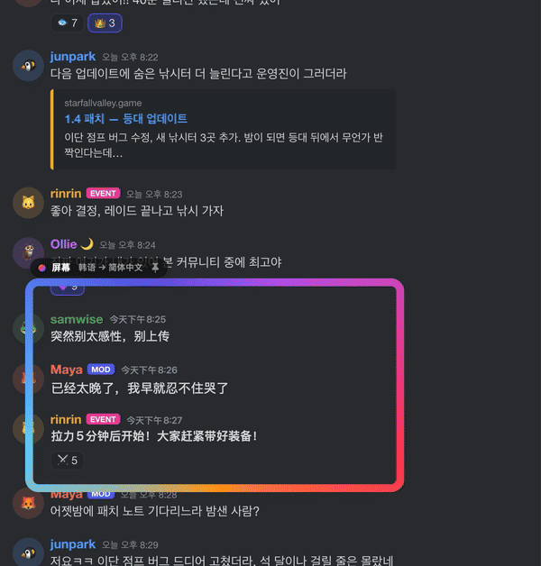

<p align="center">
  
</p>

<h1 align="center">Mwoyeo</h1>
<p align="center"><a href="README.md">한국어</a> · <a href="README.en.md">English</a> · <a href="README.ja.md">日本語</a> · <b>简体中文</b></p>
<p align="center"><b>实时屏幕翻译：画面在变，译文就在原处跟着变。</b><br>
聊天消息刷新、字幕切换、页面滚动，透镜下的译文都会紧跟画面。</p>

<p align="center">
  <a href="https://github.com/midagedev/mwoyeo/releases/latest"></a>
  <a href="https://github.com/midagedev/mwoyeo/releases"></a>
  
  
  
  <a href="LICENSE"></a>
</p>

```sh
brew install midagedev/tap/mwoyeo
```

<p align="center">免费 · 开源(MIT) · macOS 26 及以上 · Apple 芯片(M1 及以上) · <a href="https://github.com/midagedev/mwoyeo/releases/latest/download/Mwoyeo-arm64.dmg">直接下载磁盘映像</a></p>

<p align="center"><br>
<sub><a href="docs/media/hero.zh-CN.full.gif">观看 20 秒完整演示（含滚动、显示原文）</a></sub></p>

画面变化时，Mwoyeo 会一直翻译下去。它反复识别透镜下的文字，**把原文从画面上抹掉**，再按原来的位置、大小和颜色写上译文：新消息一进来就译，字幕一切换就译，页面滚到哪里就译到哪里。没有弹窗，也没有字幕条，屏幕上直接就是中文（或你设定的其他语言）。默认情况下，所有处理都在 Mac 本地完成，屏幕上的内容不会发往任何地方。只有当你自己添加云端翻译引擎时，透镜读到的文字才会发送给该引擎。

## 安装

```bash
brew install midagedev/tap/mwoyeo
```

也可以直接[下载磁盘映像](https://github.com/midagedev/mwoyeo/releases/latest/download/Mwoyeo-arm64.dmg)，把 Mwoyeo 拖进“应用程序”文件夹。App 已签名并经过公证。

Mwoyeo 每天会到 GitHub 检查一次新版本，有更新时菜单里会提示。用 `brew upgrade mwoyeo` 更新，或者下载新的磁盘映像即可。在“设置 › 关于”里可以手动检查更新、关闭自动检查，也能找到发布说明和问题反馈页面的链接。

### 系统要求

| | |
|---|---|
| **macOS** | 26.0 或更高版本（不用语言包翻译和*高保真*引擎需要 26.4 或更高版本） |
| **Mac** | 运行 macOS 26 或更高版本的 Apple 芯片 Mac（M1 及更新机型）或 MacBook Neo。没有 Intel 版本。 |
| **权限** | 只需“屏幕录制”，不需要“辅助功能”，也不监听键盘 |
| **网络** | 默认设置下翻译不需要联网。唯一的网络请求是每天一次的更新检查，可以关掉。你自己添加的云端引擎是唯一的例外。 |
| **磁盘** | App 本身约 20 MB。语言包（以及 Apple Intelligence 模型，最多 8–14 GB）由 macOS 负责下载和存放。 |
| **显示器** | 数量不限，透镜可以放在任意一块显示器上 |

**本地运行的各个部分，以及各自的要求。** 所有处理都在 Mac 本地完成，差别只在于有哪个引擎可用。

| 功能 | 要求 |
|---|---|
| 识别文字（Vision）、擦除文字（Core ML） | 没有额外要求，符合上述条件的 Mac 都行 |
| 用**语言包**翻译（最快，可离线） | 对应语言组合的语言包，下载一次即可：在 Mwoyeo 的“设置 › 翻译”或“系统设置 › 通用 › 语言与地区 › 翻译语言”中下载 |
| **不用语言包**翻译、*高保真*引擎、*术语表优先* | 在“系统设置 › Apple 智能与 Siri”中打开 **Apple Intelligence**。不用语言包翻译和*高保真*引擎需要 macOS 26.4 或更高版本 |

符合上述条件的 Mac 都支持 Apple Intelligence，不过还有两个前提：Mac 的语言和 Siri 的语言必须是同一种受支持的语言；另外，中国大陆无法使用 Apple Intelligence。在 Mwoyeo 支持的语言里，Apple Intelligence 支持英语、韩语、日语、中文、法语、德语、西班牙语、意大利语、葡萄牙语和越南语，不支持俄语、乌克兰语和泰语，这三种语言只能用语言包翻译。没有 Apple Intelligence 时，Mwoyeo 全部改用语言包翻译。

**语言。** 英语、韩语、日语、中文（简体和繁体）、法语、德语、西班牙语、意大利语、葡萄牙语（巴西）、俄语、乌克兰语、越南语和泰语之间都能互译，前提是 macOS 有这个方向的翻译模型。选择*自动*时，会逐行识别源语言。App 界面支持英语、韩语、日语、中文（简体和繁体）、法语、德语、西班牙语、意大利语、葡萄牙语（巴西）、俄语和乌克兰语。

## 快速上手

1. **打开 Mwoyeo。** Mwoyeo 常驻菜单栏（取景器图标），欢迎窗口会带你走完剩下的步骤。
2. **允许屏幕录制。** 点按**允许**，然后在“系统设置 › 隐私与安全性 › 录屏与系统录音”中打开 Mwoyeo。之后如果透镜里还是空的，退出 Mwoyeo 再重新打开。
3. **选择语言。** *翻译自*保持**自动**即可；*翻译为*默认是 Mac 的系统语言。
4. **下载语言包**（推荐）。在 Mwoyeo 的“设置 › 翻译”中，点按语言组合旁边的**下载**。装了语言包，翻译几乎是即时的，还能离线使用。不装的话改由 Apple Intelligence 翻译，不用下载，但每行大约要 1 秒。
5. **按 ⌃⌥L，拖拽框选**想看的文字，比如 Discord 频道的消息列表或 Reddit 帖子。也可以直接点按，透镜就放在点按的位置。操作时按住 ⌥，透镜会固定在屏幕上，而不是跟随窗口（见下文）。

## 使用透镜

- **移动**：拖动透镜发光的边框，或顶部的名称标签。译文始终贴在下方的文字上，只显示透镜范围内的部分。
- **调整大小**：拖动右下角。
- **关闭**：点按名称标签上的 ✕（指针移到透镜上才会出现）。
- **滚动、聊天照旧。** 透镜内部的点按会直接穿透下去，下面的页面照常可用。新消息一来就翻译，滚动时译文也跟着走。
- **窗口透镜与屏幕透镜。** 放在窗口上的透镜是*窗口透镜*（名称标签上显示 🪟），跟着窗口移动，窗口最小化或被遮住时会隐藏。*屏幕透镜*（📌）则停在你放的位置，不管下面是哪个 App 都照样翻译，适合放在字幕行上，或者下方经常切换 App 的地方。点按名称标签上的图标即可切换。
- **透镜越小越好。** 只框住要看的部分（框聊天区，别框整个浏览器），翻译更快，也更省电。可以同时开多个透镜。

菜单栏图标里会列出所有透镜，可以逐个开关、移除，或者添加新透镜。菜单里还有**显示原文**、**暂停**和设置。

### 快捷键

以下快捷键在任何 App 里都能用。可以在“设置 › 快捷键”中更改或移除：点按某个快捷键，再按下新的组合键。macOS 不会告诉 App 某组按键是否已被其他 App 占用，所以如果某个快捷键在别处也有作用，请换录一个。默认快捷键已经避开了 Rectangle、Magnet 等窗口管理工具。

| | |
|---|---|
| ⌃⌥L | 添加透镜（拖拽框选区域，或点按放置；按住 ⌥ 固定到屏幕） |
| ⌃⌥O | 显示原文 / 译文 |
| 无 | 全部暂停、重新翻译（在菜单中；需要的话可以在设置里为它们指定按键） |
| 无 | 拷贝原文、朗读、存储透镜图像（作用于指针下方的透镜，没有的话作用于最新的透镜） |

### 透镜菜单

右键点按透镜的名称标签，就能看到可以对该透镜做的所有操作。

- **显示原文**、**拷贝原文**、**拷贝译文**：两个拷贝命令会按阅读顺序拷贝透镜里的文字。
- **朗读**：用系统语音朗读译文。没有该语言的语音时，请在“系统设置 › 辅助功能 › 朗读内容”中添加。
- **存储透镜图像**：把叠着译文的透镜画面存储为 PNG。
- **为（App 名称）记住语言**：只在窗口透镜上显示。把当前语言组合绑定到该 App，之后该 App 位于最前面时，语言会自动切换。语言组合同一时间只能用一组，所以最前面那个 App 的设置会作用于所有透镜。记住的 App 可以在“设置 › 翻译 › 按应用设置语言”里清除。

## 翻译图像

点按菜单栏面板下方的照片图标（**翻译图像…**），会打开图像翻译窗口。把图像文件拖进去，或按 ⌘V 粘贴，就会像透镜一样抹掉原文并写上译文。结果可以作为图像或文字拷贝，也可以存储。

## 添加其他翻译引擎

如果 Apple 翻译够用，什么都不用做。想要更自然的译文，可以在“设置 › 翻译 › **添加其他引擎…**”里添加你平时在用的引擎。

- **在此 Mac 上**：Ollama、LM Studio，或你自己运行的 LibreTranslate、DeepLX。不需要密钥，文字不会离开这台 Mac。
- **云端**：Gemini、OpenAI、Claude、DeepL、DeepSeek、OpenRouter、Groq、Qwen 等。粘贴密钥、选好模型后，会用试译立即确认连接是否正常。密钥只存储在 macOS 钥匙串中。
- **自行连接**：OpenAI 兼容服务器、几行就能写好的 HTTP 模板、收发 JSON 的命令。引擎配置可以用**拷贝配置**交给别人，用**粘贴配置**接收。密钥不会包含在配置里。

添加引擎后，菜单栏面板里会出现引擎切换按钮。添加的引擎没有响应或密钥有误时，这段时间会改用 Apple 翻译，并在面板里悄悄提示。设置里引擎列表的下方会显示得到第一个结果所用的时间，以及直接从翻译记忆取出的比例。

> **选择云端引擎后，透镜读到的文字会发送到该引擎所属公司的服务器。** 添加引擎的界面里也写明了发往哪里。只发送文字，不发送屏幕图像。

下面是各引擎的简单测量结果（2026-10-17，M1 Pro，每次翻译一批三行文字。测量方法和完整表格见 [tools/engine-bench/RESULTS.md](tools/engine-bench/RESULTS.md)）。

| 引擎 | 模型 | 响应（中位数） | 质量（1–5） | 费用 |
|---|---|---|---|---|
| Apple（默认） | Translation framework | 0.15 秒 | 3.4 | 免费 |
| DeepL | Free API | 0.88 秒 | 4.6 | 免费额度 |
| Gemini | gemini-3.1-flash-lite | 1.27 秒 | 4.6 | 免费额度 |
| Claude | claude-haiku-5-5 | 1.12 秒 | 4.6 | 付费 |
| OpenAI | gpt-5.6-luna | 1.35 秒 | 4.8 | 付费 |
| Ollama | translategemma:4b | 1.00 秒 | 3.6 | 免费，在此 Mac 上 |

Apple 翻译最快；云端引擎要多花一秒左右，换来的是结合上下文的译文。

## 设置

| 标签页 | 可以调整的内容 |
|---|---|
| 通用 | 语言 · **显示方式**：*自适应*（默认选项，画面移动时显示普通色块，静止后无缝重写）、*快速*（始终用色块，最省电）或*无缝*（始终重写）· 屏幕检查频率（4、8 或 15 fps）· 登录时打开 · **存储**：把透镜读到的原文和译文存成 Markdown 和 SRT 记录，以及存放记录和透镜图像的文件夹（默认 `~/Documents/Mwoyeo`） |
| 翻译 | **引擎**：*自动*（装了语言包就用语言包，否则用 Apple Intelligence）、*高保真*（始终用 Apple Intelligence，最自然但也最慢）或*术语表优先* · 语言包 · **翻译记忆**：保留多少条译文供复用（1,000、5,000 或 20,000 条；只存在内存里，退出 Mwoyeo 即清空）· **术语表**：专有名词，每行一条 `original = translation` · **添加其他引擎** · **按应用设置语言**（只有在透镜菜单里记住过某个 App 之后才会显示） |
| 外观 | **透镜样式**：*光晕*、*柔和*（只在读取时发光）或*极简*（一条淡淡的细线，悬停时才显示名称标签）· 字体（默认、圆体、衬线）· 色块不透明度 · 用 AI 擦除带纹理的背景（照片和插画） |

## 小技巧与常见问题

- **一直卡在“正在翻译…”？** 多半是没装语言包，到“设置 › 翻译”里下载即可。另外，安装后的第一个透镜也会慢一些，因为 macOS 要先加载一次文字识别模型。
- **名字翻得不对**（角色名、地名、用户名）？把它们加进术语表，再选*术语表优先*。
- **更新后什么都不显示？** macOS 有时会重新索要屏幕录制权限。到“系统设置”里确认一下，然后重新打开 Mwoyeo。
- **想对照原文？** 按 ⌃⌥O 看原文，再按一次切回来。
- **隐私。** Mwoyeo 只读取透镜下方的内容，默认设置下从不保存或发送。打开记录存储后，只会写入你指定的文件夹；添加云端引擎后，透镜读到的文字会发送到该引擎。截取画面时也会把自己的叠加层排除在外。除此之外，它唯一会向互联网查询的，是 GitHub 上的最新版本号，每天一次，可以在“设置 › 关于”中关闭。检查更新的方式是下载发布页附带的一个小文件，所以 GitHub 的下载次数就是使用统计：安装只计一次，使用每月只计一次，不会发送任何能识别你这台 Mac 的信息。

## 技术细节

每个环节用的都是 Apple 的设备端框架：

| 环节 | 技术 |
|---|---|
| 捕捉 | ScreenCaptureKit：每个透镜一路流，排除 Mwoyeo 自己的叠加层，只在像素变化时输出帧 |
| 文字识别 | Vision `VNRecognizeTextRequest`（行、感兴趣区域）；按位置和间距把行归为段落 |
| 翻译 | Translation 框架：有语言包时用低延迟的语言包，没有时用高保真的 Apple Intelligence 模型 |
| 按术语表翻译 | Foundation Models（设备端语言模型），可选 |
| 擦除 | 纹理背景在 GPU 上用 Core ML 版 MI-GAN 做图像修复，纯色背景用快速扩散填充 |
| 界面 | SwiftUI 搭配 Liquid Glass、菜单栏附加项、全局快捷键，界面支持 12 种语言 |

### 工作原理

```
ScreenCaptureKit ──► change map (16 px tiles) ──► scroll? shift blocks, read only the new strip
      │                       │
      │                       └─► changed rows ──► Vision (ROI) ──► erase ──► translate (lens first) ──► overlay
      │
      └─► still for 0.5 s ──► whole-frame paragraph pass ──► seamless re-render, cross-faded in
```

捕捉范围比透镜大一圈（即“过扫描”）。静止时，每边各留出相当于透镜尺寸约 30% 的余量；内容或透镜移动时扩大到约 40%，并向移动方向偏移。透镜可以在捕捉区域里自由移动，快到边缘时捕捉范围才重新居中，这时也只读取新露出来的条带。没变化的文字会沿用之前擦好的背景；内容移动期间算出的结果平移后继续用，不会丢掉；翻译队列也总是先处理看得见的内容。

滚动分两步跟踪。触控板和滚轮的输入会在下一帧到来之前，先让译文跟着页面移动；每捕捉到一帧，再按列测出精确到亚像素的偏移量，把译文校准到位，所以固定的侧边栏或消息输入框不会把聊天内容拖着走。只读取新滚入视野的那一条。

擦除时，纯色和渐变背景直接用周围的颜色填充；遇到有纹理的背景（插画、游戏画面），则由设备端的图像修复模型重建背景，译文也会用相应的字重和字号排版。

上面的动图就是 App 本身，运行在一个虚构的聊天页面（`demo/chat.html?lang=ko`）上，用真实的鼠标和触控板滚动录制。拍摄清单见 `docs/HERO.md`。

名字来自韩语方言：*mwoyeo*（뭐여）就是“那是啥？”的意思。

## 开发

构建、测试和发布的方法见[英文 README](README.en.md#development)。

## 致谢

图像修复模型：Picsart AI Research 的 [MI-GAN](https://github.com/Picsart-AI-Research/MI-GAN)，MIT 许可证（`tools/inpaint/models/LICENSE-MI-GAN-WEIGHTS`）。`tools/inpaint/models` 里的 Core ML 版本由 `tools/inpaint/convert_migan.sh` 转换而来。

## 许可证

MIT
